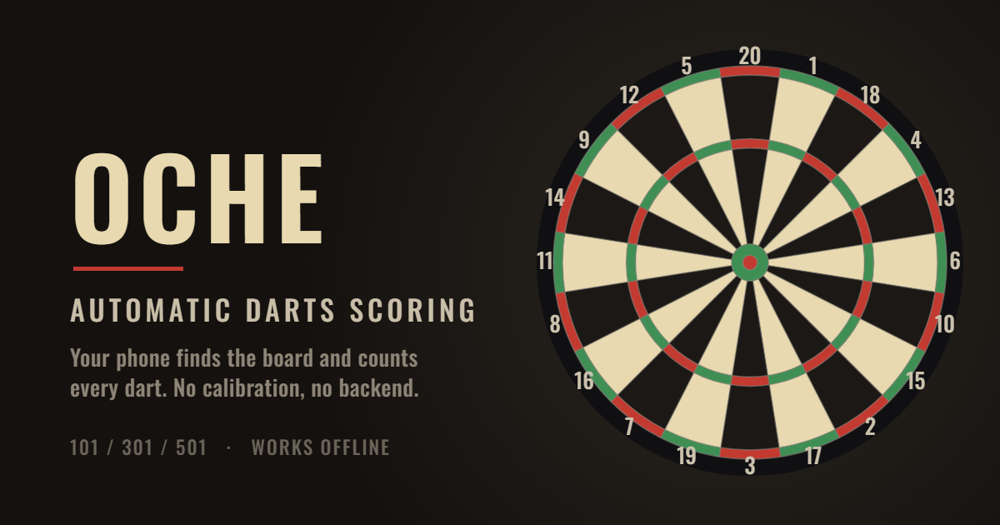

  

<h1 align="center">Oche</h1>

  <b>Stand at the oche and throw. Your phone keeps score.</b> 
  A darts scorer that finds the board in the camera frame and counts every dart on its own.

  <a href="https://oche.tinkered.app/"><b>▶ Play it</b></a>
  &nbsp;·&nbsp; 101 / 301 / 501
  &nbsp;·&nbsp; installs as an app
  &nbsp;·&nbsp; works offline
  &nbsp;·&nbsp; no backend

---

Prop the phone opposite the board and play. Oche finds the board in the frame,
recognises each dart as it lands, and subtracts the points. Nothing to tap
between throws, and no "click four corners" calibration. The only setup is the
players' names.

Plain HTML, CSS and JavaScript with no backend: the camera image never leaves
the phone, and every frame is analysed in the browser.

The interface starts in English; Polish is in **Settings → Language**, and
the choice is remembered between legs. The colours follow the device's light or
dark mode unless you pick one in **Settings → Theme**.

## Playing

1. Stand the phone somewhere steady (tripod, shelf, a box, anything that
   doesn't move) with the whole board in frame, and press **Turn on the camera**.
2. Wait for **"Board clear, throw"**. That's the whole setup.
3. Throw. Each dart appears in the strip under the score and the points come off
   by themselves. After the third dart the app asks you to pull the darts.
4. Pull them, press the big button, the other player throws. Down to zero, and
   once the leg is won the big button becomes **New game**.

The status bar says what is happening: "Waiting for a dart", "Movement in the
frame", "Board covered, step out of the frame", "Triple 20 = 60". Counting
pauses on its own while you stand in front of the board or pull darts out.

### Three ways to enter throws

The switch above the preview picks how you work, and the choice is remembered:

- **Camera**: the automatic one. The app finds the board and counts the darts.
- **Board**: tap a drawn dartboard where the dart landed.
- **Keypad**: tapping a number scores a single, so most throws are one tap. For
  a double or triple, tap **×2** or **×3** first (it lights up), then the
  number: **×3**, `20` → `T20`. The multiplier applies to that one dart and
  switches itself off, so there is no mode to forget about; tapping the lit
  button again cancels it. Separate buttons for BULL 50, 25 and a miss.

Outside camera mode the image analysis and the camera itself are switched off,
so nothing is written in the background and the phone doesn't heat up for
nothing.

### Every dart is visible and fixable

Three tiles under the score show the current turn. Tapping a tile opens a
fix: first the beds this dart is easiest to confuse with (the same number in
another ring, the neighbouring numbers), then under "Another bed" the full
picker (multiplier plus number, bull, 25 and a miss). A dart can also be
deleted when the camera saw something that never happened.

A hit that landed closer than 2 mm to a wire gets a yellow question mark,
both on the tile and on the camera image. Those are the hits where the detector
can be one bed out, so they are worth a glance.

### Settings

The **Settings** menu opens on the game picker, and the keyboard stays down until
you tap a name field yourself:

- **game**: 101 (a quick leg), 301 or 501,
- **player names**,
- **language**: English or Polish. It switches immediately and is remembered
  separately from the leg. Names nobody edited follow the language; names you
  typed stay,
- **theme**: match the device, light or dark. It switches immediately and is
  remembered,
- **double out**: only a double or the bulls-eye ends the leg, and leaving one
  point is a bust. Changing the rules mid-leg starts a new one (rescoring old
  throws under new rules would rewrite what already happened); names and the
  other settings stay,
- **closest separate hits** (4 / 8 / 15 mm): a hit closer than this to a dart
  already counted in the turn is taken for that same dart. A smaller value
  counts tight groups better, a larger one filters out a dart still shaking
  after it lands.

### Install it as an app

Oche installs from the browser and runs like a normal app: full screen, no
address bar, its own icon:

- **Android / Chrome:** **Settings → Install app** inside Oche, or Chrome's
  ⋮ menu → *Install app*. It lands in the app drawer and on the home screen,
  shows up in recent apps as Oche, and Chrome's install sheet previews it
  with screenshots,
- **iPhone / Safari:** Share → *Add to Home Screen*.

After the first run it works without internet, because the files are cached
locally. With a connection the network is always tried first, so a new version
shows up the next time you open it.

---

## How it works

### Finding the board without calibration

The board's strongly saturated colours are the red and green (on some soft-tip
boards blue) beds of the doubles, trebles and bull. Colours are told apart by
hue, so a warm bulb that turns sisal and wood orange does not make them red. From
those beds:

1. **the ellipse of the outer double edge** → how much the board is squashed in
   frame (the affine part of the transform). Along each direction from the
   centre the coloured pixels form bands, and the double is the band with the
   treble at about 0.6 of its radius and bare singles in between. That ratio
   holds for every board and is what keeps a coloured surround, a speckled
   number ring or a logo out of the outline,
2. **the bull centre** → which side the camera is looking from. The bull's offset
   from the ellipse centre encodes the perspective; a circle-preserving
   projective transform closes it (a translation in the Klein model),
3. **the red/green alternation around the board** → rotation. The pattern repeats
   every 36°. On a steel-tip board bed 20 is black with red rings; on some
   soft-tip boards it is light with green rings, which shifts the pattern by one
   bed and colour cannot tell the two apart. The steel-tip layout wins while bed
   20 is within 15° of the top of the frame; the reversed one only when it is
   within 3°, so such a board has to hang level and the phone has to be upright.

A frame holds more than the board, so the search does not trust any single
cue. Large single-coloured areas (surrounds, walls, cabinets) are dropped first.
Several candidate centres are tried: blobs of one colour ringed by the other
(the bull), the densest patches of red-meets-green points (which also finds a
small board in a busy room), and the middle of all coloured pixels. Each
candidate gets the full fit, and the one whose bed layout matches best wins.
When nothing matches well, the search runs again on a white-balanced copy of
the frame.

The fit is then refined: the app tries small nudges and checks which one makes
the layout of the beds (red, green, black and sisal) agree best with what is
actually visible (600 control points).

On 12 photographs of different boards (steel-tip and soft-tip, face-on and
oblique, bare and in red or green surrounds, warm and cold light, down to a
board 38 px in radius in a room) 11 are recognised with 91–100% of the control
points matching. The one that fails is a board about 40 px in radius under
strongly orange light, where half the red beds read as sisal. On synthetic boards
generated from a known homography the reprojection error is 0.8–1.5% of the
radius, against a double ring 4.7% wide.

### Detecting throws

The app looks at the board about 5 times a second and watches the order of
events:

- **movement gate**: while anything in frame is moving (a player, a hand, a dart
  in flight), comparison against the background is suspended,
- **occlusion threshold**: if more than 20% of the board's area changed,
  someone is standing in front of it,
- **colour difference** against the remembered background frame, per R/G/B
  channel: a white dart on sisal has the same brightness as the background, only
  colour gives it away. A change shared by the whole board (auto-exposure, white
  balance) is measured and taken out first. The area compared reaches 1.3 times
  the double's radius, because a dart in a double shows mostly outside it,
- **joining the pieces**: the bright barrel, the dark shaft (nearly invisible on
  a black bed) and the bright flight often come out as separate blobs. Nearby pieces are always joined; distant ones only when
  they share an axis: the parts of one dart line up along it, two darts side by
  side do not. Without this one throw would be counted several times,
- **a solid core**: the blob must contain a dozen-odd pixels that really do
  contrast with the background. Fluorescent flicker, exposure drift and
  compression noise produce weak, smeared changes and fall out here,
- **shape**: a dart is elongated; a round speck is not one,
- **confirmation**: the blob has to sit in the same place across three
  consecutive analyses. That filters out a dart caught in flight, the shadow of a
  passing hand, and a dart still shaking after it lands. The tip reported is the
  average of those sightings,
- **distance**: a hit closer than 8 mm to a dart already counted in the turn is
  taken for that same dart, still shaking,
- **board size**: the pixel sizes above suit a board about 130 px in radius in
  the analysed frame and are rescaled to the board actually seen,
- **lasting changes**: if the still board stays "covered" for about four
  seconds, it is a change of light, not a player, and becomes the new background.

### Knowing where the tip is

This is the hardest part of the whole app. The visible thick part of a dart ends
a dozen-odd millimetres short of where it went in, and the thin needle is one or
two pixels wide on the image and barely stands out against the board. So:

1. the dart's principal axis is computed from its pixels: the direction to
   search along for the tip (the segment between the extreme pixels is no use,
   because wide flights skew it by up to a dozen degrees),
2. the thinner end is picked: narrow at the tip, wide at the flight. Ties are
   broken by perspective, since the flight is closer to the camera and moves away
   from the frame axis,
3. from that end the app hunts for the needle at a much lower threshold,
   following its trace sideways. The threshold rises with the frame's noise, so
   in dim light the trace does not run on into grain,
4. if the needle isn't visible at all (steel on bright sisal can give no contrast
   whatsoever), the tip is extended geometrically by 15% of the dart's visible
   length, but only when the blob ends on something thick. When the tip of the
   blob is thin, the needle is already inside it and nothing needs extending.

In the end-to-end test (a camera fed a photo of a real board, 25 throws into
known points) this gives a mean radial error of 0.1 mm and a worst case of
2.1 mm.

A counted dart becomes part of the background, so the next throws are recognised
separately. Slow changes in light are absorbed by the background refresh.

### Scoring

The hit point goes through the homography onto a flat board, where scoring is
plain polar geometry (radii normalised to 170 mm):

| Distance from centre | Bed |
|---|---|
| ≤ 0.037 | bulls-eye (50) |
| ≤ 0.094 | outer bull (25) |
| 0.582 – 0.629 | triple (×3) |
| 0.953 – 1.000 | double (×2) |
| > 1.000 | off the board (0) |
| everything else | single |

The sector number comes from the angle: 18° per bed, from 20 at the top going
clockwise (20, 1, 18, 4, 13, 6, 10, 15, 2, 17, 3, 19, 7, 16, 8, 11, 14, 9, 12, 5).

### The rules it keeps

- counting down from the chosen value (101 / 301 / 501) to exactly zero,
  3 darts per turn,
- **bust**: going below zero returns the score to what it was before the turn and
  ends it. With double out, so does reaching zero without a double, and leaving
  one point,
- a **checkout hint** under the player's score, e.g. `checkout: T20 T20 BULL`,
  worked out under the chosen rules,
- statistics: darts thrown and average per turn,
- **undo**, plus fixing and deleting individual darts. The game state is
  recomputed from scratch out of the event list, so every correction immediately
  reworks the score, the turns and any busts.

---

## When something goes wrong

| Symptom | What to do |
|---|---|
| "I cannot see the board" | The whole board has to be in frame and well lit. |
| "The board is seen too flat" | Move the phone round to face the board more squarely. |
| "Board covered" | Step out of the camera's line after your throw. |
| A dart wasn't counted | Tap it on the image and it gets added by hand. |
| One throw counted twice | Delete the extra one from its tile. |
| A hit with no throw | Delete it from the tile. Usually flickering light or shadows; the app filters those, but in very poor light it can lose. |
| Wrong bed | Tap the dart's tile and pick the right bed. |
| The phone moved | Press **Find board** (or pull the darts, and the fit refreshes by itself). |
| No camera / no HTTPS | Switch to **Board** or **Keypad**. |

---

## Limits

- **The phone has to stay still.** The fit ties pixels to the board; move it and
  the fit needs refreshing (which happens automatically after each turn).
- **No lens distortion in the model.** The homography assumes a perspective
  projection; wide-angle lenses bend the edges of the frame, so the board should
  sit in the middle of the image.
- **Needle visibility.** When the needle doesn't stand out from the board the tip
  is extended by estimate, which is the most common source of a one-bed miss near an
  edge. Those hits are marked with a question mark and a tap fixes them.
- **Dart shadow.** In hard side light the shadow enlarges the blob and can shift
  where the tip is read.
- **Two darts in one place.** A hit closer than the configured gap (8 mm by
  default) to an earlier dart in the turn is taken for that same dart, so a very
  tight group can be counted once. The threshold is in the menu, and a missing
  dart is added by tapping the image.
- **Pulling the darts** has to be confirmed with the button: otherwise darts
  disappearing would look like new hits.

---

## Your data

Oche has no accounts and no server-side storage. The camera image is analysed
in the browser and never leaves the phone, and the app loads nothing from other
sites.

What the browser keeps, in its local storage for this site:

- the current leg: game settings, player names and every throw,
- the language and the theme.

The service worker also caches the app's own files so it works offline.
Cloudflare serves those files; the Worker's logs are switched off.

The full note for visitors, including what Cloudflare records and what
happens to email, is the privacy page
([public/privacy.html](public/privacy.html)), linked from the footer.

## Restoring

- **Code:** the repository is the source of truth. Deploying it again restores
  the site; the command is in [AGENTS.md](AGENTS.md).
- **Data:** there is nothing to restore on a server. A leg lives only in the
  browser that played it. Clearing the site's data resets the game and the
  settings, and it cannot be recovered.

## Credits

Made by Kuba (kuba@tinkered.app), part of [tinkered.app](https://tinkered.app).

The Oswald typeface is by The Oswald Project Authors, under the SIL Open Font
License 1.1 ([public/fonts/OFL.txt](public/fonts/OFL.txt)).

## Development

Commands, conventions and the project layout are in [AGENTS.md](AGENTS.md).
